# Dependency Graph

Last updated: 0000164-hardening-and-backlog-skill

## Component dependency diagram

```mermaid
graph TD
    subgraph "ravintio-zero (component-pack)"
        SKILLS["skills/ (orchestrator + phase skills)"]
        STANDARDS["standards/, templates/, schemas/"]
        SETUP["setup.sh / setup.ps1"]
        GITHOOKS["git hooks\n(commit-msg, pre-commit, pre-push)"]
        ENFORCE["hooks/enforcement/\n(gate-write, check-design, ratchet-check,\nem-dash-guard, merge-guard,\nauto-trigger-orchestrator, check-orchestrator-presence)"]
        ENFSHARED["hooks/enforcement/read-stdin.mjs\nshared module, always installed"]
        VERSION["scripts/product-version.mjs"]
        DRIVER["scripts/roadmap-run.mjs"]
        LABELS["scripts/roadmap-labels.mjs"]
        REFS["skills/ravintio-orchestrator/references/\n(seven orchestrator-*.md files)"]
        LOGS["plan/.roadmap-logs/step-N.log"]
    end

    subgraph "Project root"
        PRODUCT["product.yml"]
        MANIFEST["ravintio-zero/component.yml"]
    end

    subgraph "Claude Code runtime"
        CC[Claude Code agent]
        HookRunner["Hook runner (Claude Code internal)"]
    end

    subgraph "External"
        NODE["node (required, sole runtime)"]
        GH["gh and claude command-line tools"]
    end

    SETUP -->|"installs"| SKILLS
    SETUP -->|"copies + wires"| ENFORCE
    SETUP -->|"wires via core.hooksPath"| GITHOOKS
    SKILLS -->|"bundles at install time"| STANDARDS

    CC -->|"plans a tool call"| HookRunner
    HookRunner -->|"stdin JSON"| ENFORCE
    ENFORCE -->|"stdout block or additionalContext"| HookRunner

    ENFORCE --> ENFSHARED
    ENFORCE --> NODE

    ENFORCE -->|"merge-guard reads PR base"| GH
    DRIVER -->|"starts one claude -p per step"| GH
    DRIVER --> NODE
    DRIVER -->|"imports the label encoder"| LABELS
    DRIVER -->|"writes one log per step"| LOGS
    SKILLS -->|"orchestrator loads on demand"| REFS

    VERSION -->|"reads components[]"| PRODUCT
    VERSION -->|"reads version"| MANIFEST
```

---

## Edges that matter

**Every enforcement hook imports `read-stdin.mjs`.** All seven hooks share the one module. Setup copies `hooks/enforcement/` as a unit, so the import always resolves.

**Setup wires seven hooks into `.claude/settings.json`.** `gate-write`, `ratchet-check`, and `em-dash-guard` run on `PreToolUse` for Write and Edit. `merge-guard` runs on `PreToolUse` for Bash. `auto-trigger-orchestrator`, `check-orchestrator-presence`, and `check-design` run on `UserPromptSubmit`, in that order. Setup finds its own entries by module name on any matcher, and replaces a non-array event value with a warning.

**Two components make network calls, both on request.** `merge-guard` runs `gh pr view` to read a PR base before a merge. `roadmap-run.mjs` starts `claude` and `gh` child processes. No other hook or script makes an outbound network call. `node` is the only dependency of the pack itself.

**The driver depends on `claude` and `gh`.** `roadmap-run.mjs` uses Node built-ins, `roadmap-labels.mjs`, the `claude` command, and `gh`. It reads `plan/current-roadmap/roadmap.md` and `plan/current/build-log.md`. It never edits the working tree.

**The driver passes a model and labels to each child.** It passes `--model` from `RAVINTIO_ROADMAP_MODEL`, which defaults to `sonnet`. It passes `--max-turns` only when `RAVINTIO_ROADMAP_MAX_TURNS` is set. If a `RAVINTIO_*` name is unset, the driver reads the legacy `PLANIFEST_ROADMAP_MODEL` or `PLANIFEST_ROADMAP_MAX_TURNS` in 1.x, and the `RAVINTIO_*` value wins if both are set. It appends `work.kind`, `ravintio.roadmap`, and `ravintio.step` labels to `OTEL_RESOURCE_ATTRIBUTES` in the child environment.

**The driver writes one log per step.** Each step writes stdout and stderr to `plan/.roadmap-logs/step-{position}.log`. The driver excludes the folder through `.git/info/exclude` and leaves `.gitignore` alone. Every stop line names the log.

**The orchestrator reads seven reference files on demand.** Rarely used sections live in `skills/ravintio-orchestrator/references/orchestrator-*.md`, and the Pack Index lists each one. The Exception Stops table stays in `SKILL.md`.

**A sixth exception stop reads the approved dependency list.** The list is `design.md` "Approved dependencies" in a gated or autonomous run, and `roadmap.md` "## Dependencies" in a roadmap step. The stop fires in every run when work adds a library or service that is not on the list.

**`product-version.mjs` reads `components[].id` and each component's `version`.** It derives the product version under `versionPolicy: max-component-version`. No code reads the top-level `id` in `product.yml`. The orchestrator's discovery hard stop requires it.

**Node is the sole runtime.** Every hook is a `.mjs` file invoked as `node <script>`. There is no `jq` dependency and no bash entry point, so the hooks run identically on macOS, Linux, and Windows.
