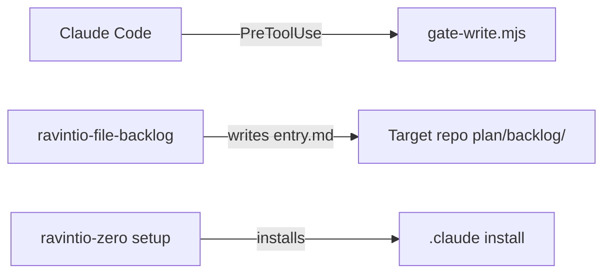

# Execution Plan - hardening and backlog skill

> Every requirement must be traceable to a user story or acceptance criterion.

**Skill:** plan
**Feature:** 0000164-hardening-and-backlog-skill
**Version:** 1.1.0
**Status:** active

## Active Skills

| Skill | Scope | Purpose |
|-------|-------|---------|
| None | | No capability skill applies |

## Decisions referenced

| ADR | Decision |
|-----|----------|
| ADR-001 | The stack stays as declared, with no new dependency |
| ADR-002 | `gate-write` scopes to the project by real path |
| ADR-003 | Setup retires the telemetry cleanup and keeps the retired-hooks list |
| ADR-004 | `ravintio-file-backlog` never touches the target repo's git state |

## Functional Requirements Directory

| File | Requirement | Source |
|------|------------|--------|
| [req-001-gate-write-outside-project.md](requirements/req-001-gate-write-outside-project.md) | `gate-write` passes targets whose real path is outside the project | US-001 |
| [req-002-gate-write-documented-scope.md](requirements/req-002-gate-write-documented-scope.md) | Name `plan/backlog/` and `plan/roadmap/`, and correct the gate docs | US-002 |
| [req-003-bash32-test-loops.md](requirements/req-003-bash32-test-loops.md) | Five suites drop `done < <(...)`, plus a guard test | US-003 |
| [req-004-retire-telemetry-cleanup.md](requirements/req-004-retire-telemetry-cleanup.md) | Setup drops the telemetry cleanup in both shells | US-004 |
| [req-005-file-backlog-skill.md](requirements/req-005-file-backlog-skill.md) | New `ravintio-file-backlog` skill | US-005 |
| [req-006-gate-write-symlink-cases.md](requirements/req-006-gate-write-symlink-cases.md) | Symlink, alias, and Windows cases of the outside-project rule | US-001 |
| [req-007-gate-write-doc-correction.md](requirements/req-007-gate-write-doc-correction.md) | Correct the gate description in `CLAUDE.md` and three other files | US-002 |
| [req-008-bash32-guard-test.md](requirements/req-008-bash32-guard-test.md) | Guard test for `done < <(` and the full-suite check | US-003 |
| [req-009-retire-telemetry-tests-and-docs.md](requirements/req-009-retire-telemetry-tests-and-docs.md) | Telemetry suite changes, manifest update, and changelog note | US-004 |
| [req-010-file-backlog-guardrails-and-catalogue.md](requirements/req-010-file-backlog-guardrails-and-catalogue.md) | Never-commit rule, catalogue row, and skill-count suites | US-005 |

## Build order

Each track works on its own files, so the tracks run in parallel except where noted.

1. **Batch 1, parallel:**
   - REQ-001, REQ-006, REQ-002, then REQ-007 in one track. REQ-001, REQ-006, and REQ-002 edit `gate-write.mjs`, so they run in sequence. REQ-007 edits docs only.
   - REQ-003 then REQ-008 in `ravintio-zero/tests/`. REQ-003 edits the five suites. REQ-008 adds the guard test and runs the full suite.
   - REQ-004 then REQ-009 in `setup.sh`, `setup.ps1`, `component.yml`, and the telemetry suites. REQ-009 carries the test, manifest, and changelog changes.
   - REQ-005 then REQ-010 in `ravintio-zero/skills/ravintio-file-backlog/`, the catalogue, and the two skill-count suites.
2. **Batch 2, sequential:** the full suite runs on Bash 5 and on macOS Bash 3.2 under `env -i`. The living docs update after that.

REQ-003 and REQ-004 both touch `ravintio-zero/tests/` but edit different files. REQ-003 must not edit a suite that REQ-004 deletes. None of the five REQ-003 files is on REQ-004's delete list.

## Non-Functional Requirements

| ID | Category | Requirement | Target | Measurement |
|----|----------|------------|--------|-------------|
| NFR-001 | Performance | `gate-write` adds no process or network call | 0 new calls | Code review |
| NFR-002 | Regression | Existing suites on every shell | All pass on Bash 3.2, Bash 5, Windows PowerShell 5.1, and PowerShell 7 | CI matrix and a local `env -i` run |
| NFR-003 | Correctness | Suites using `done < <(` under `tests/` | 0 | REQ-003 guard test |

## API Summary

Not applicable. The pack exposes no API.

## Data Model Summary

Not applicable. No component owns data.

## Component Interactions

## Assumptions

| ID | Assumption | Impact if Wrong |
|----|-----------|----------------|
| A-001 | No live consumer still carries pre-0000033 telemetry wiring | Stale settings entries stay until the consumer removes them by hand |

## Open Questions

None.
